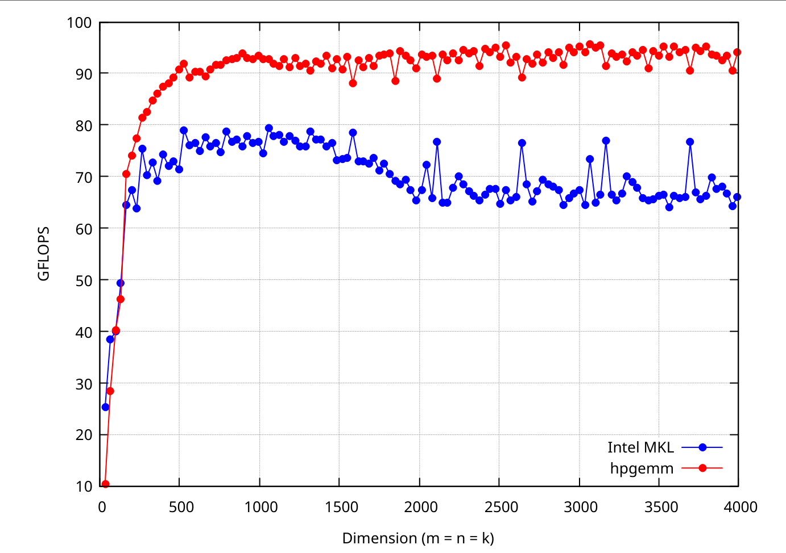
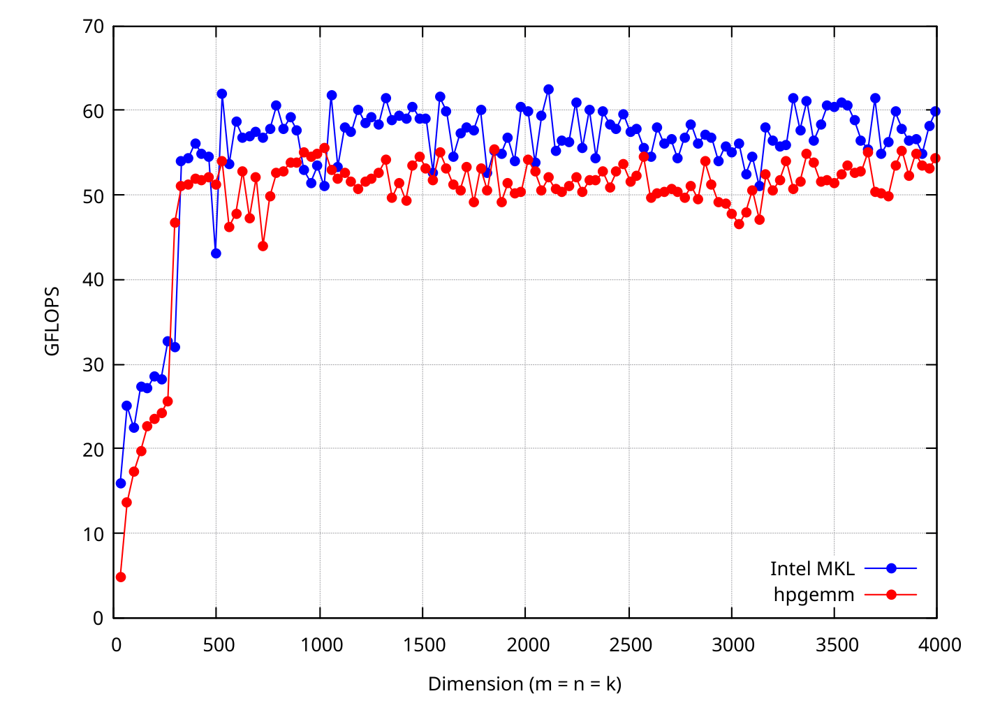
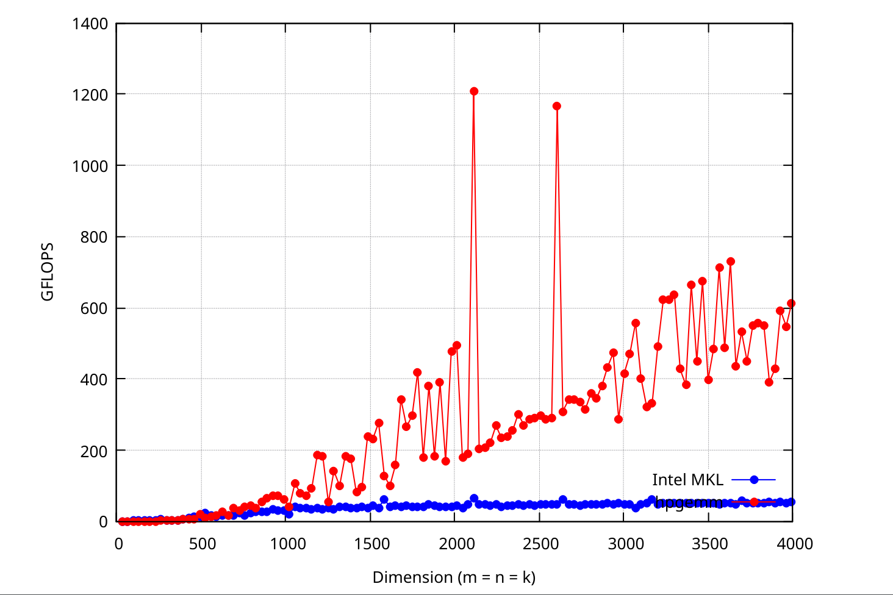
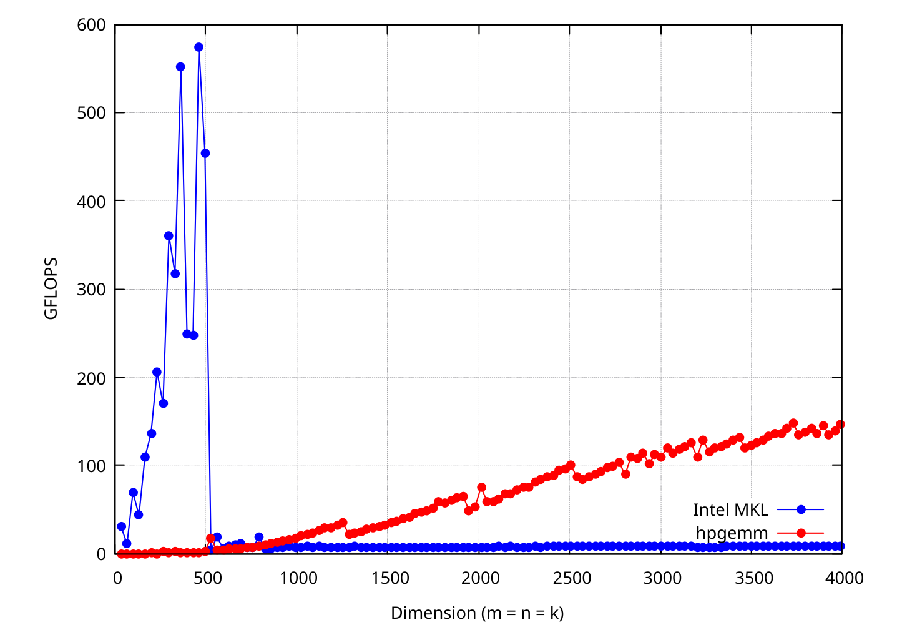

# hpgemm

A high-performance FP32 GEneral Matrix-Matrix Multiplication (SGEMM) implementation inspired by GOTO's algorithm.

The implementation uses cache blocking, matrix packing, register blocking, SIMD handwritten micro-kernels with inline assembly, and OpenMP. Ships with an AVX2 kernel for x86_64 and an ARM NEON kernel for ARM CPUs, an empirical analysis tool for finding good blocking parameters, and a benchmark suite for comparing against Intel MKL.

## Performance

The benchmark compares hpgemm against Intel MKL SGEMM on square matrices. Benched using `./bench 3 33 4000 33`.

### Single thread score

<p align="center">
  <figure>
    
    <figcaption align="center">AMD EPYC 7302</figcaption>
  </figure>
</p>

<p align="center">
  <figure>
    
    <figcaption align="center">Intel Xeon E5-2683</figcaption>
  </figure>
</p>

### Multi thread

<p align="center">
  <figure>
    
    <figcaption align="center">AMD EPYC 7302 (64 cores)</figcaption>
  </figure>
</p>

<p align="center">
  <figure>
    
    <figcaption align="center">Intel Xeon E5-2683 (64 cores)</figcaption>
  </figure>
</p>

## Build

Code is strict C99, should be compilable using both GCC and Clang. We also need OpenMP, and Intel MKL (only for the benchmark).

```
make
```

If MKL is not installed in the default location, point `MKLROOT` at it:

```
make MKLROOT=/path/to/mkl
```

MKL is x86_64 only. On ARM, build just the empirical tool:

```
mkdir -p data/empirical
make empirical
```

## Benchmark

```
./bench <repetitions> <start_dim> <end_dim> <step>
```

For example:

```
./bench 3 33 4000 33
```

It runs both a single-threaded and a multithreaded pass (all available threads), checks hpgemm's result against MKL, and writes the results to `data/perf/` (`mkl_1t.dat`, `hpgemm_1t.dat`, `mkl_mt.dat`, `hpgemm_mt.dat`).

To plot them (requires `gnuplot`):

```
./view.sh
```

## Empirical analysis

Block sizes depend on the cache hierarchy, so `empirical` sweeps them on a single thread and reports the best values.

```
./empirical <mckc|nc> <repetitions> <start_dim> <end_dim> <step>
```

- `mckc` scans `MC` x `KC` and writes `data/empirical/mckc.dat`, ready for `splot`.
- `nc` scans `NC` and writes `data/empirical/nc.dat`. The effect is only visible when the matrix dimensions are larger than `NC`.

For example:

```
./empirical mckc 5 512 2048 256
./empirical nc 5 2048 4096 256
```

## PS (project_structure) :3

- `hpgemm.c` / `hpgemm.h`: the blocked and packed GEMM driver
- `kernel.c`: AVX2 and ARM NEON ukernels
- `bench.c`: benchmark against Intel MKL
- `empirical.c`: blocking parameter search

Peace.
